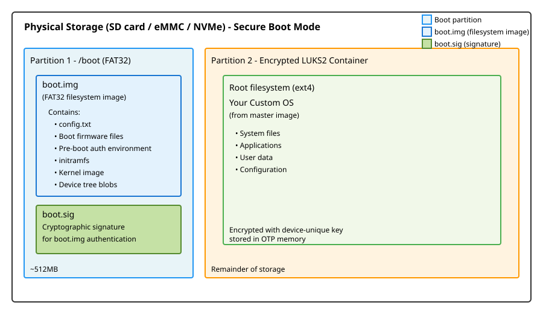
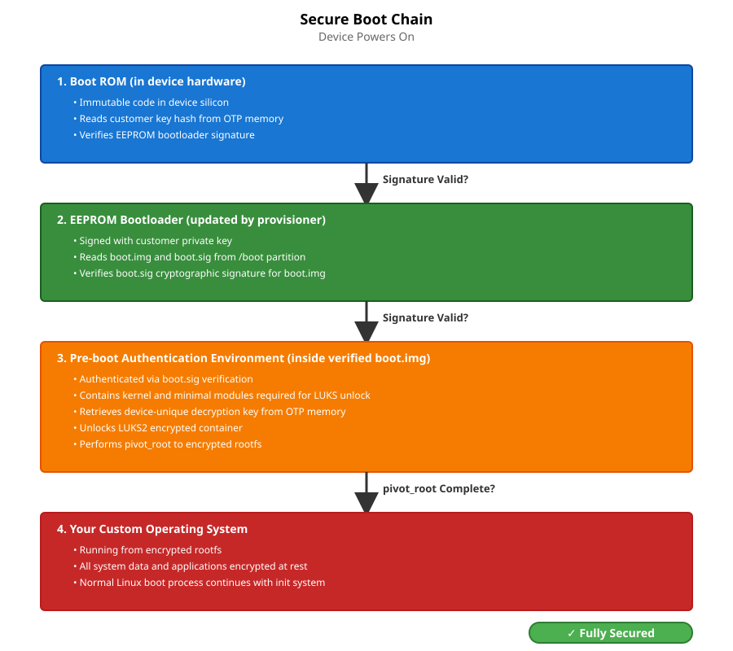
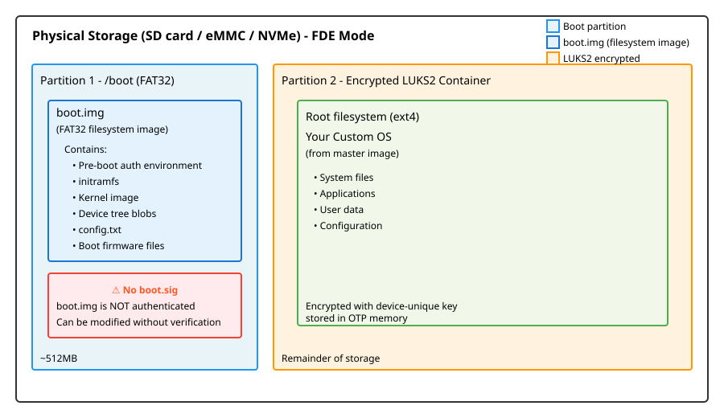
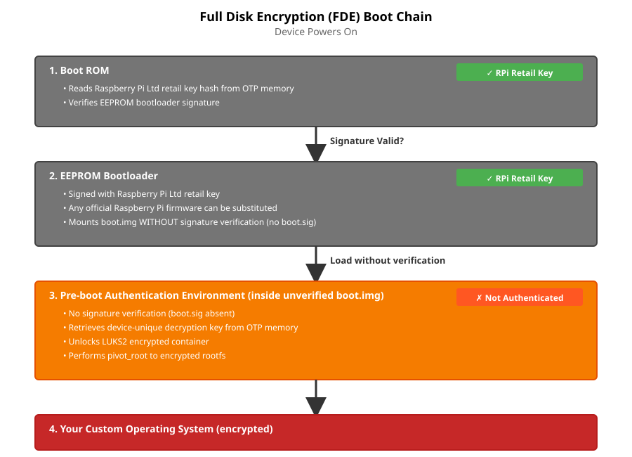
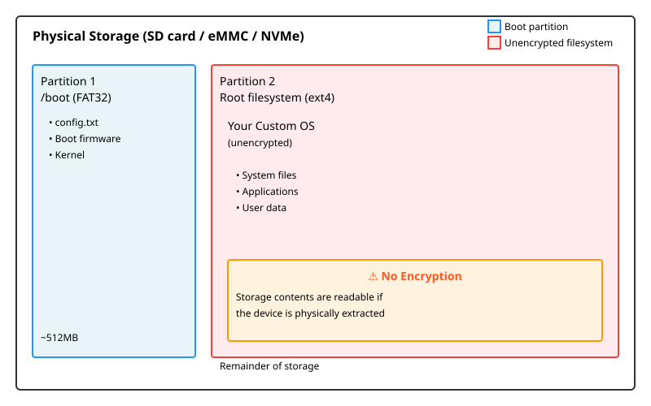

*Technical overview of the rpi-sb-provisioner system design*

# Overview

The rpi-sb-provisioner is designed around a core principle: **transparency of action**. Every operation is explicit, auditable, and uses standard Linux tools and interfaces. The system is built from composable components that can be understood, inspected, and maintained independently.

## Design Philosophy

The architecture prioritizes:

- **Transparency:** All operations are visible through standard Linux tools (systemd, journalctl, filesystem)

- **Auditability:** Comprehensive logging at every stage; operations can be traced and verified

- **Composability:** Separate concerns into distinct components that communicate through well-defined interfaces

- **Simplicity:** Prefer shell scripts and standard tools over complex frameworks

- **Security:** Minimize attack surface; operations run with minimal necessary privileges

- **Maintainability:** Code should be readable by system administrators, not just developers

## High-Level Architecture

The system consists of five main components:

| Component            | Purpose                                            | Implementation         |
|----------------------|----------------------------------------------------|------------------------|
| **udev Rules**       | Detect device connections and trigger provisioning | udev rule file         |
| **systemd Services** | Orchestrate provisioning workflow phases           | systemd template units |
| **Shell Scripts**    | Execute provisioning operations                    | POSIX shell scripts    |
| **Web Service**      | Provide monitoring and configuration interface     | C++ (Drogon framework) |
| **Configuration**    | Store provisioning parameters and state            | Filesystem-based       |

# Component Architecture

## 1. Device Detection (udev)

The provisioning workflow begins with device detection.

### udev Rules (`/usr/lib/udev/rules.d/60-rpi-sb-provisioner.rules`)

A first rule de-authorises the USB mass-storage interface a device in RPIBOOT mode may offer, so only the rpiboot vendor interface is used. Two more detect Raspberry Pi devices in different boot states:

**Rule 1: RPIBOOT mode detection**

    ACTION=="add", SUBSYSTEM=="usb",
      ATTRS{idVendor}=="0a5c", ATTR{idProduct}=="2764|2711|2712",
      TAG+="systemd",
      PROGRAM="/usr/bin/systemd-escape -p --template=rpi-sb-bootstrap@.service $env{DEVNAME}",
      ENV{SYSTEMD_WANTS}+="%c"

**Triggers when:** Raspberry Pi device connects in RPIBOOT mode (bootloader USB mode)

**Action:** Start `rpi-sb-bootstrap@.service` with the device path as parameter

**Product IDs:**
- `2764` - Raspberry Pi 3 family devices (Zero 2 W)
- `2711` - Raspberry Pi 4 family devices (Raspberry Pi 4, Compute Module 4)
- `2712` - Raspberry Pi 5 family devices (Raspberry Pi 5, Compute Module 5)

**Rule 2: fastboot mode detection**

    ACTION=="add", SUBSYSTEM=="usb",
      ATTRS{idVendor}=="18d1", ATTR{idProduct}=="4e40",
      ATTR{manufacturer}=="Raspberry Pi",
      TAG+="systemd",
      PROGRAM="/usr/bin/systemd-escape -p --template=rpi-sb-triage@.service $attr{serial}",
      ENV{SYSTEMD_WANTS}+="%c"

**Triggers when:** Device has been bootstrapped and enters fastboot mode

**Action:** Start `rpi-sb-triage@.service` with the device serial number as parameter

### Why This Design?

- **Automatic triggering:** No manual intervention required; plugging in a device starts provisioning

- **systemd integration:** Leverages systemd’s service management, logging, and monitoring

- **Device isolation:** Each device gets its own service instance (systemd template units)

- **Standard interface:** Uses udev, the standard Linux device management system

## 2. Provisioning Workflow (systemd Services)

Provisioning proceeds through three phases, each implemented as a systemd template service.

> **Warning**
>
> Provisioning is triggered automatically when a device is connected.
> All provisioners erase the device’s storage before writing the OS image.
> Triage, and each provisioner again, refuses a `GOLD_MASTER_OS_FILE` that is unset, missing, empty or unreadable, or an IDP directory without exactly one JSON descriptor, before storage is touched, and marks the failure permanent.
> Bootstrap does not check the image, so by then a secure-boot device already has the key hash in OTP and an updated EEPROM.
> Always ensure a valid image is selected before connecting a device.

### Phase 1: Bootstrap (`rpi-sb-bootstrap@.service`)

**Purpose:** Initialize device, program security keys, update firmware

**Triggered by:** udev rule detecting RPIBOOT mode

**Key operations:**

- Refuse a Raspberry Pi 4 or 5 whose family differs from `RPI_DEVICE_FAMILY`

- Run the `bootstrap` customisation hook

- Raspberry Pi 4 and 5 families only: build an EEPROM image from the newest `pieeprom-*.bin` under `/lib/firmware/raspberrypi/bootloader-<chip>/latest/`, or the firmware chosen on the Options page, with the bootloader configuration chosen there (Default or Custom). Bootstrap works on a copy, in which it moves storage first in `BOOT_ORDER` when `RPI_DEVICE_BOOT_ORDER_MATCH_STORAGE` is on and from which it removes any `SIGNED_BOOT`: a customer key in OTP turns signed boot on, and without one the setting would stop an unsigned OS booting. The image is flashed over rpiboot

- Secure boot only: sign the EEPROM configuration (and, on Raspberry Pi 5, the bootcode) with the customer key, and program the key hash into OTP (`program_pubkey=1`), with JTAG lock, EEPROM write protection and, on Raspberry Pi 4, the RPIBOOT GPIO if configured

- Load the fastboot gadget through rpiboot. The Zero 2 W takes this step alone: it has no EEPROM and no secure boot

A board that refuses the bootcode three times stops the run at once, marked permanent, with a hint in the log that it may hold a customer key and need the reprovision flag.

**Script:** `/usr/bin/rpi-sb-bootstrap.sh`

**Logging:** `/var/log/rpi-sb-provisioner/<serial>/bootstrap.log` (written under `/var/log/rpi-sb-provisioner/early/` until the serial is known)

**State tracking:** `BOOTSTRAP-STARTED`, `BOOTSTRAP-FINISHED` or `BOOTSTRAP-ABORTED` rows in the state database

**Time limit:** one hour for the whole unit (`RuntimeMaxSec=1h`)

### Phase 2: Triage (`rpi-sb-triage@.service`)

**Purpose:** Determine provisioning mode and start appropriate provisioner

**Triggered by:** udev rule detecting fastboot mode

**Key operations:**
- Refuse a device on a USB port the port allowlist excludes
- Refuse an unusable `GOLD_MASTER_OS_FILE` (see the warning above)
- Check the device answers over fastboot and reports the serial it was started for
- Provision the device unique secret (`oem fwcrypto init`) if not already present — every provisioned device receives one regardless of provisioning style, as it is used for HMAC-based LUKS key derivation and device identity
- Capture the device public key to the log directory or a configured retrieval path. The private key is captured too if the device will still export it, but provisioning the key locks the OTP slot, so in practice only the public key is retained
- Read configuration to determine provisioning route:
  - If `GOLD_MASTER_OS_FILE` is an IDP artefact directory, start `rpi-idp-provisioner@.service` regardless of `PROVISIONING_STYLE`
  - Otherwise, start a provisioner based on `PROVISIONING_STYLE`:
    - `secure-boot` → `rpi-sb-provisioner@.service`
    - `fde-only` → `rpi-fde-provisioner@.service`
    - `naked` → `rpi-naked-provisioner@.service`

**Script:** `/usr/bin/rpi-sb-triage.sh`

**Logging:** `/var/log/rpi-sb-provisioner/<serial>/triage.log`

**State tracking:** `TRIAGE-STARTED`, `TRIAGE-FINISHED` or `TRIAGE-ABORTED` rows in the state database

**Time limit:** ten minutes (`TimeoutStartSec=10min`)

### Phase 3: Provisioning (`rpi-*-provisioner@.service`)

**Purpose:** Deploy operating system and configure security

Four variants implement different security and deployment models:

**IDP Provisioner** (`rpi-idp-provisioner@.service`)

- Uses a JSON image descriptor and sparse images produced by `rpi-image-gen`

- Erase device storage

- Stage JSON descriptor and initialise device-side partition layout (`idpinit`)

- Write partition table and encryption metadata (`idpwrite`)

- Flash sparse images in a device-driven loop: device requests each partition via `idpgetblk`, host flashes the corresponding `.simg` file

- Finalise provisioning (`idpdone`): device completes encryption setup and verification

- All partition creation and encryption is handled device-side by fastbootd, not by host scripts

**Secure Boot Provisioner** (`rpi-sb-provisioner@.service`)

- Build `boot.img` from the OS image's boot partition, with the pre-boot authentication initramfs (kernel modules copied from the image) in place of the image's own, and sign it with the customer key as `boot.sig`. The result is cached in `RPI_SB_WORKDIR` for later devices

- Erase device storage via fastboot

- Have the device create a DOS partition table, a FAT boot partition and a second partition filling the rest (`oem partinit`, `oem partapp`)

- Have the device create and open a LUKS2 container on the second partition with `RPI_DEVICE_STORAGE_CIPHER` (`oem cryptinit`, `oem cryptopen`); the device derives the unlock material from its device unique secret

- Flash the boot partition, and the OS image's root filesystem into the container

- Turn off the device's power LED

The EEPROM was already signed and written by bootstrap.

**Full Disk Encryption Provisioner** (`rpi-fde-provisioner@.service`)

- As the secure boot provisioner, but `boot.img` is not signed

- On Zero 2 W, the pre-boot files go directly into the boot partition rather than into `boot.img`

**Naked Provisioner** (`rpi-naked-provisioner@.service`)

- Erase device storage via fastboot

- Flash the OS image whole, as supplied, with no encryption: its own partition table and boot files are used. A copy is flashed instead if `bootfs-mounted` or `rootfs-mounted` hooks are enabled, or if the image's length must be padded to a multiple of 4096 bytes

- Turn off the device's power LED

Every provisioner runs the `provision-started` hook before its work and the `post-flash` hook after flashing, and records manufacturing data. The secure boot, FDE and naked provisioners also run the `bootfs-mounted` and `rootfs-mounted` hooks against the mounted image; the IDP provisioner does not.

**Scripts:**
- `/usr/bin/rpi-idp-provisioner.sh`
- `/usr/bin/rpi-sb-provisioner.sh`
- `/usr/bin/rpi-fde-provisioner.sh`
- `/usr/bin/rpi-naked-provisioner.sh`

**Logging:** `/var/log/rpi-sb-provisioner/<serial>/provisioner.log`

**State tracking:** `<STYLE>-PROVISIONER-STARTED`, `-FINISHED` or `-ABORTED` rows in the state database, such as `SB-PROVISIONER-FINISHED`

**Time limit:** six hours for the whole unit (`RuntimeMaxSec=6h`), as a backstop; each fastboot command has its own limit (see [Time limits](#time-limits))

**Boot image generator** (`rpi-sb-image-bootimg-generator@.service`) is a separate one-shot unit, started by the web UI when an OS image is uploaded, that builds a signed `boot.img` for updating devices already in the field. It runs no customisation hooks and is more tightly sandboxed than the provisioners. See [boot-img-generator.md](boot-img-generator.md).

### Why This Design?

- **Phase separation:** Each phase has clear responsibilities and can be debugged independently

- **Service isolation:** systemd ensures proper resource management and cleanup

- **Parallel execution:** Multiple devices can be provisioned simultaneously

- **Standard monitoring:** Use `systemctl` and `journalctl` for service inspection

- **Transparent state:** State files allow external monitoring without querying the service

## 3. Shell Script Implementation

Core provisioning logic is implemented in POSIX shell scripts.

### Script Structure

**Common functions** (`rpi-sb-common.sh`)

Shared utilities used by all phases:

- Configuration reading (`read_config`)

- Logging functions

- Device information extraction

- USB path resolution

- Fastboot route selection, including TCP image transfer when an Ethernet
  route to the device is up and answers with the device's own serial number

- Bounded commands (`run_bounded`, `timeout_fatal_secs`, `fastboot_flash`)
  and failure reporting

- The `provision-failed` hook (`run_provision_failed_hook`)

- Temporary directory management (`make_temp_dir`, `cleanup_orphans`)

### Time limits

No step waits for ever. Each fastboot call runs under `timeout` with a
limit suited to its work:

| Variable                     | Default  | Used for                                              |
|------------------------------|----------|-------------------------------------------------------|
| `FASTBOOT_CONTROL_TIMEOUT`   | 30 s     | `getvar`, LED and other quick commands                |
| `FASTBOOT_STORAGE_TIMEOUT`   | 120 s    | Partition tables, LUKS format and open                |
| `FASTBOOT_ERASE_TIMEOUT`     | 900 s    | Erasing the whole device                              |
| `FASTBOOT_PRESENCE_TIMEOUT`  | 10 s     | Checking the board is there before a long command     |

A flash is allowed 120 s plus time in proportion to its size, at an assumed
5.5 MiB/s. Before any command longer than the presence limit, the board must
answer `getvar version` within `FASTBOOT_PRESENCE_TIMEOUT`, and a board that
goes away part-way through a long command is given up on after the same
time. rpiboot is stopped after three `Failed control transfer` refusals with
no second stage reached. Customisation hooks are limited to
`RPI_SB_HOOK_TIMEOUT` seconds, 1800 by default. The units' own limits
(above) are a backstop.

When a bounded command fails, the per-device log records why, including the
reason the device gave for refusing it, and `PROVISION_FAILED_REASON` is set
to one of `device-refused`, `board-absent`, `board-lost`, `bootcode-refused`,
`timed-out` or `command-failed`. A service stopped by a signal is recorded
as aborted. The `provision-failed` hook then runs with
`PROVISION_FAILED_CONTEXT` (`bootstrap` or `provisioning`),
`PROVISION_FAILED_PERMANENT` (`1` for a failure that retrying will not fix,
such as no OS image or a refused bootcode) and `PROVISION_FAILED_REASON`.

**Phase-specific scripts**

Each phase has a dedicated script implementing its operations:

- Entry point receives device identifier from systemd

- Sources common functions

- Implements phase-specific logic

- Updates state files

- Records manufacturing data

- Returns exit code to systemd

### Why Shell Scripts?

- **Transparency:** Operations are explicit command invocations, easy to trace

- **Debuggability:** Can be run manually for testing and troubleshooting

- **Standard tools:** Uses openssl, cryptsetup, fastboot, and other standard utilities

- **Inspectability:** System administrators can read and understand the code

- **Portability:** POSIX shell is universally available on Linux systems

- **Auditability:** Every command is visible in logs with `set -x`

## 4. Web Service (provisioner-service)

A web service provides monitoring, configuration, and API access.

### Implementation

**Technology:** C++ using Drogon web framework

**Purpose:**
- Web-based configuration interface
- Real-time device monitoring
- Manufacturing database access
- REST API for integration
- WebSocket support for live updates

### Architecture

`rpi-provisioner-ui.service` listens on `127.0.0.1`, port 3142 for HTTP and 3143 for HTTPS with a self-signed certificate kept in `/var/lib/rpi-sb-provisioner/tls/`. `--address`, `--port`, `--https-port`, `--disable-https` and `--allowed-host` change this.

**Pages** (the navigation bar): Devices, Options, Customisation, Services, Manufacturing Database, Audit Log and Code Scanner, plus Sign in, or the signed-in user's name (API tokens) and Sign out.

**Access:** operators sign in with a system account in the `rpi-sb-provisioner` group, checked through PAM (`/etc/pam.d/rpi-provisioner-ui`); scripts send an API token as `Authorization: Bearer`. Unless `RPI_SB_PROVISIONER_PUBLIC_DASHBOARD` is turned off, the devices page, a device's own page and the code scanner can be viewed without signing in, but never its logs, keys or settings. Every state-changing route is POST-only and needs the session's CSRF token. Requests for a host name the service does not answer to are refused. Signing in to a non-loopback address needs HTTPS.

**HTTP endpoints:**

- `/options/*` - Configuration management, including `/options/bootloader-config`, the bootloader configuration editor

- `/devices/*` - Device status, logs and keys

- `/api/v2/services` - Service monitoring

- `/api/v2/manufacturing` - Manufacturing database queries

- `/customisation/*` - Provisioning script management

- `/images/list`, `/analyze-image` - OS image management (traditional and IDP artefacts)

- `/login`, `/logout`, `/auth/*`, `/api/v2/tokens` - Sign-in and API tokens

- `/auditlog` - Audit log

- `/internal/state-changed`, `/internal/manufacturing-recorded` - Local-only notifications from provisioning scripts to refresh WebUI state promptly

**WebSocket endpoints:**

- `/ws/devices` - Real-time device topology updates

- `/ws/sha256` - Live hash calculation progress

- `/ws/progress`, `/ws/boot-package` - Upload and boot package progress

**Views:** Server-side templates (CSP files compiled to C++)

**Data sources:**

- systemd API (D-Bus) - Service status

- Filesystem - Logs, configuration

- SQLite - State database, manufacturing database, audit log

### Why This Design?

- **Separation of concerns:** The web service monitors and configures; the shell scripts do the provisioning

- **Privileged but confined:** The web service runs as root, because it writes the configuration and hooks the provisioners run as root, but is sandboxed by systemd (see [Privilege Separation](#privilege-separation)). Internal notification endpoints are restricted to loopback clients and a per-boot shared token.

- **Standard protocols:** HTTP REST API and WebSockets for integration

- **Stateless monitoring:** Service reads state from the state database; does not maintain critical state

- **Fail-safe:** If web service crashes, provisioning continues unaffected

## 5. Configuration and State Management

### Configuration (`/etc/rpi-sb-provisioner/config`)

Simple key-value file format:

    PROVISIONING_STYLE=secure-boot
    RPI_DEVICE_FAMILY=5
    RPI_DEVICE_STORAGE_TYPE=nvme
    CUSTOMER_KEY_FILE_PEM=/path/to/key.pem
    GOLD_MASTER_OS_FILE=/path/to/image.img

**Read by:** All shell scripts via `read_config` function, and by systemd as each unit's `EnvironmentFile`, after the package defaults in `/usr/share/rpi-sb-provisioner/defaults/config`

**Modified by:** Web service or manual editing. The web service accepts only the provisioner's own settings, on one line each. The file is readable by root only.

The bootloader configuration devices get is chosen on the Options page: **Default**, the package's `/var/lib/rpi-sb-provisioner/bootloader.secure` (secure boot) or `bootloader.naked` (other styles), or **Custom**, `/etc/rpi-sb-provisioner/bootloader.conf`, written by the editor at `/options/bootloader-config`. Saving checks the file and the EEPROM's size limit. Custom sets `RPI_DEVICE_BOOTLOADER_CONFIG_FILE`; Default clears it.

**Why:** Simple, transparent, version-controllable, easy to backup

PEM signing keys uploaded through the WebUI and stored HSM PINs are device-wrapped at rest using a key derived from the provisioning Raspberry Pi firmware crypto device key. PKCS#11/HSM keys are referenced by URI and used through OpenSSL `pkcs11-provider`.

#### The host device key

Wrapping is not optional: with no usable device key the service **refuses** to
store a signing key or an HSM PIN, rather than falling back to plaintext. That
makes the device key a precondition for configuring a provisioning station at
all, so the service checks for one at startup, and again at each point it is
asked to store a secret — not once at install time. Every one of those paths —
the PIN, an uploaded PEM key, wrapping a saved key, and the plaintext migration
— refuses with `409` and names both the reason and, where there is one, the
remedy, so the operator is never left with a bare failure whose cause reached
only the journal.

The classification is cached, but asymmetrically. A failure is remembered for a
few seconds only, because the conditions behind one are the ones that change —
the slot being programmed while the service runs, by Raspberry Pi Connect
registering or `rpi-fw-crypto genkey` from the command line — and a station that
answered "no" once should not keep saying so until it is restarted. A usable key
is not re-probed on a timer, since it is on the hot path of every wrap and
unwrap; instead, an operation the firmware refuses invalidates the
classification that said it would not, which catches `HMAC_LOCKED` being set at
runtime sooner than a poll would.

Note that the firmware crypto service is reached through `/dev/vcio_crypto`, not
`/dev/vcio` — different nodes, with different permissions.

The distinction matters because the key is **not programmed at the factory**. On
BCM2712 there is exactly one OTP key slot, id 1, and it is the device-unique
slot; a station that has never had a key programmed reads it back as all zeros.
Raspberry Pi Connect programs it as a side effect of registration, which is why
many hosts have one already, but a jig imaged for provisioning and nothing else
will not. Such a host reports `no_signing_key`-style refusals from every
secret-storing path until a key exists.

Where the slot is blank, the Options page offers to generate one. This writes
OTP permanently and is deliberately a separate, confirmed action: it is never
attempted as a silent repair from a path that merely needed a key, and package
installation no longer does it either. `GET /options/device-key-status` reports
the classification; `POST /options/provision-device-key` performs the write and
requires an explicit confirmation token in the body.

Note that `config.txt`'s `lock_device_private_key=1` sets `READ_LOCKED` on the
slot, which prevents reading the private key but does **not** prevent generating
one — generation is gated by the separate `GEN_LOCKED` flag. A locked-but-blank
slot can still be provisioned.

### Signing Helpers

Secure-boot signing can use either a PEM key or a PKCS#11 URI. Both wrappers
route through `rpi-sb-keyhelper` so that secret material (a wrapped PEM key, or
the token PIN) is only ever unwrapped in that helper's own process memory,
never in the calling shell, on a command line, or in a `pin-source=` file:

- `rpi-sb-pem-sign.sh` invokes `rpi-sb-keyhelper`, which unwraps a device-wrapped PEM key in process memory and emits the RSA SHA-256 signature expected by Raspberry Pi signing tools.

- `rpi-sb-pkcs11-sign.sh` invokes `rpi-sb-keyhelper` with the configured `pkcs11:` URI. The helper loads the `pkcs11-provider` and `default` providers, resolves the URI through `OSSL_STORE`, and supplies the device-wrapped token PIN in-process via OpenSSL's passphrase callback so the token's `C_Login` succeeds. Public-key derivation for the URI (`init_signing_context`) goes through the same helper for the same reason.

The provider-load and PIN-unwrap logic is shared between the helper and the web
service's key-validation path via `pkcs11_common`, a small translation unit kept
free of the web-server dependency.

This keeps persistent key material and the token PIN encrypted at rest and
avoids the deprecated OpenSSL ENGINE path for HSM signing. See the
[PKCS#11 / HSM Support guide](hsm-support.md) for supported tokens and setup.

### State Tracking (`/srv/rpi-sb-provisioner/state.db`)

Each script records every state change as a new row in the `devices` table of
an SQLite database, through `record_state()` in
`/var/lib/rpi-sb-provisioner/state-recording`. A row holds:

- Serial number
- Endpoint (the USB path)
- State, such as `BOOTSTRAP-STARTED`, `SB-PROVISIONER-WRITING-ROOTFS` or `TRIAGE-ABORTED`
- Image summary, IP address and board type
- Timestamp

After each write the script notifies the web service at
`/internal/state-changed`, so the Devices page updates at once.

**Purpose:** Allow web service and external tools to monitor progress without interfacing with systemd

**Persistence:** The database survives reboots, so a device's history stays visible

### Logging (`/var/log/rpi-sb-provisioner/`)

Directory structure:

    /var/log/rpi-sb-provisioner/
      <serial>/
        bootstrap.log       # Bootstrap phase operations
        triage.log          # Triage phase operations
        provisioner.log     # Provisioning phase operations
        keypair/            # Device keys, root-only, unless
                            # RPI_DEVICE_RETRIEVE_KEYPAIR names a directory
          <serial>.der      # Private key, PEM-encoded. Only written while the
                            # OTP key-slot is unlocked; normally absent.
          <serial>.pub      # Public key, PEM-encoded
      early/                # Bootstrap logs until the serial is known
      bootimg-generator/    # Boot image generator logs

The log tree is readable by root and the `rpi-sb-provisioner` group only.

**Log format:** Timestamped entries with explicit command output

**Retention:** Persists across reboots. The package installs no log rotation for it

**Why:** Comprehensive audit trail; troubleshooting; compliance

### Locking

Bootstrap takes a per-device lock directory, so a device that re-enumerates
mid-run is not bootstrapped twice:

    /var/lock/rpi-sb-bootstrap/
      <serial>/

It is removed when bootstrap ends, successfully or not. While one exists,
a triage that fails during bootstrap's USB churn does not run the
`provision-failed` hook.

The provisioners share cached images in `RPI_SB_WORKDIR`, and build them under
`flock` locks in `/var/lock/rpi-sb-provisioner/` (such as
`pre-boot-auth-images.lock` and `rootfs-image.lock`), so concurrent devices do
not build the same image twice.

### Manufacturing Database (SQLite)

Optional database recording device information.

**Location:** `RPI_SB_PROVISIONER_MANUFACTURING_DB`, by default `/srv/rpi-sb-provisioner/manufacturing.db`

**Schema:** Single table with device attributes:
- Serial number
- Board type and revision
- MAC addresses (Ethernet, Wi-Fi, Bluetooth)
- Storage information
- Security configuration
- Provisioning timestamp
- OS image details

**Purpose:** Track provisioned devices for inventory, warranty, and compliance

# Provisioned System Architecture

After provisioning is complete, the device has a specific security architecture depending on the provisioning mode.

## Secure Boot Mode: Complete Architecture

In secure boot mode, the device implements a complete authenticated boot chain with encrypted storage.

### Storage Layout

**Boot partition structure:**

Partition 1 contains two special files:

- **`boot.img`:** A FAT32 filesystem image file containing all boot components (firmware, kernel, initramfs, pre-boot authentication environment). The EEPROM bootloader mounts this image to access boot files.

- **`boot.sig`:** Cryptographic signature for `boot.img`, signed with customer private key. The EEPROM bootloader verifies this signature before mounting `boot.img`.

This encapsulation ensures the entire boot environment is authenticated as a single unit.

### Secure Boot Chain

The boot process implements cryptographic verification at each stage:

**Key security properties:**

- **Authenticated boot chain:** Each component cryptographically verifies the next before execution

- **Customer key in hardware:** Key hash burned into device OTP memory (permanent, cannot be changed)

- **Signed components:** Only components signed with customer private key will execute

- **Encrypted storage:** All OS data protected by LUKS2 encryption

- **Device unique secret:** Each device has hardware-held secret material used to derive its LUKS unlock secret

- **Automatic unlock:** The pre-boot environment uses rpifwcrypto to derive the unlock secret; no user interaction required

- **Minimal pre-boot environment:** Contains only kernel and modules necessary for LUKS unlock and pivot_root

### Security Guarantees

**What this prevents:**

- **Unauthorized code execution:** Device will not execute code not signed with customer key

- **Storage extraction:** Removing storage and reading it on another system yields only encrypted data

- **Key extraction from storage:** LUKS unlock material is derived from device hardware state, not stored on the storage device

- **Device cloning:** Derived unlock material is unique per device, so cloning storage to another device does not make it decryptable

- **Boot chain tampering:** Any modification to EEPROM bootloader or pre-boot environment will fail signature verification

**What this requires:**

- **Secure key management:** Customer private key must be protected (used for signing)

- **Trust in device hardware:** Security depends on device OTP memory and secure key storage

## Full Disk Encryption (FDE) Mode: Architecture

FDE mode provides encrypted storage without secure boot enforcement.

### Storage Layout

**Boot partition structure:**

Partition 1 contains:

- **`boot.img`:** A FAT32 filesystem image file containing boot components (pre-boot authentication environment, kernel, initramfs). The EEPROM bootloader mounts this image to access boot files.

- **No signature file:** Unlike secure boot mode, there is no `boot.sig` file. The `boot.img` is loaded without verification.

The storage layout is similar to secure boot mode (boot partition + LUKS2 container), but without boot authentication. On Zero 2 W, which has no EEPROM and cannot load `boot.img`, the boot partition holds the pre-boot files directly.

### Boot Chain

**Key differences from secure boot mode:**

- **Raspberry Pi retail key:** EEPROM bootloader authenticated with Raspberry Pi Ltd retail key (not customer key)

- **Firmware substitution:** Any official Raspberry Pi firmware release can be substituted

- **No pre-boot verification:** Pre-boot authentication environment loaded WITHOUT signature verification

- **Encryption only:** Storage is encrypted, but pre-boot environment can be modified

- **Same unlock mechanism:** Uses OTP-stored decryption key and pivot_root

**Use case:** Scenarios requiring encryption without full boot chain authentication restrictions.

## Naked Mode: Architecture

Naked mode provides basic OS deployment without security features.

**Boot partition structure:**

Partition 1 contains boot files directly (traditional Raspberry Pi layout):

- Standard boot firmware files

- Kernel and device tree files

- No encapsulation in `boot.img`

- No signature files

### Storage Layout

### Boot Chain

    Device Powers On → Bootloader → Firmware → Kernel → Your OS

**Characteristics:**

- **No encryption:** Storage contents readable if device is extracted

- **EEPROM authenticated:** EEPROM bootloader uses Raspberry Pi retail key authentication

- **Kernel not authenticated:** No signature verification of kernel or boot files

- **Standard boot:** Conventional Raspberry Pi boot process

- **Fastest provisioning:** No encryption operations during deployment

**Use case:** Development environments, non-security-critical deployments, maximum compatibility.

## Comparison of Provisioning Modes

| Feature                             | Secure Boot                   | FDE Only                             | Naked                    | IDP                                   |
|-------------------------------------|-------------------------------|--------------------------------------|--------------------------|---------------------------------------|
| **EEPROM authentication**           | ✓ Customer key                | ✓ RPi retail key                     | ✓ RPi retail key         | Defined by artefact                   |
| **Pre-boot environment auth**       | ✓ Customer key                | ✗ No                                 | N/A                      | Defined by artefact                   |
| **Storage encryption**              | ✓ Yes (LUKS2)                 | ✓ Yes (LUKS2)                        | ✗ No                     | Defined by artefact                   |
| **Device-unique keys**              | ✓ Yes                         | ✓ Yes                                | ✓ Created, not used for storage | Defined by artefact            |
| **Customer firmware signing**       | ✓ Yes                         | ✗ No                                 | ✗ No                     | Defined by artefact                   |
| **OTP customer key**                | ✓ Yes (permanent)             | ✗ No (RPi retail)                    | ✗ No (RPi retail)        | Defined by artefact                   |
| **OTP encryption key**              | ✓ Yes                         | ✓ Yes                                | ✗ Not used               | Defined by artefact                   |
| **Storage extractable**             | ✗ No (encrypted)              | ✗ No (encrypted)                     | ✓ Yes (unencrypted)      | Defined by artefact                   |
| **Firmware substitution**           | ✗ No (customer-signed only)   | ✓ Yes (any RPi firmware)             | ✓ Yes (any RPi firmware) | Defined by artefact                   |
| **Pre-boot environment modifiable** | ✗ No (signature verification) | ✓ Yes (no verification)              | N/A                      | Defined by artefact                   |
| **Provisioning time**               | Longest                       | Medium                               | Fastest                  | Depends on artefact                   |
| **Security level**                  | Maximum                       | Medium                               | Minimal                  | Defined by artefact                   |
| **Image format**                    | Raw `.img`                    | Raw `.img`                           | Raw `.img`               | JSON descriptor + sparse images       |
| **Partition creation**              | Host-commanded (`oem partinit`, `oem partapp`) | Host-commanded (`oem partinit`, `oem partapp`) | The image's own table | Device-side from the descriptor (fastbootd) |
| **Use case**                        | Production devices            | Encryption without boot restrictions | Development, testing     | Pre-built images from `rpi-image-gen` |

# Data Flow

## Complete Provisioning Sequence

    1. Device connects in RPIBOOT mode
       ↓
    2. udev detects connection
       ↓
    3. udev starts rpi-sb-bootstrap@<device>.service
       ↓
    4. Bootstrap script:
       - Acquires device lock
       - Runs the bootstrap hook
       - Updates the EEPROM (Pi 4/5), programming the key hash into
         OTP if secure-boot
       - Boots device into fastboot mode
       - Updates state: BOOTSTRAP-FINISHED
       ↓
    5. Device reconnects in fastboot mode
       ↓
    6. udev detects fastboot device
       ↓
    7. udev starts rpi-sb-triage@<serial>.service
       ↓
    8. Triage script:
       - Checks the OS image
       - Ensures the device key, captures the public key
       - Selects the provisioner from the image and PROVISIONING_STYLE
       - Updates state: TRIAGE-FINISHED
       - Starts the provisioner service
       ↓
    9. Provisioner service starts
       ↓
    10. Provisioner script:
        - Erases storage
        - Partitions it and creates encryption (if enabled)
        - Flashes the OS image
        - Records manufacturing data
        - Runs the post-flash hook
        - Turns off the power LED
        - Updates state: <STYLE>-PROVISIONER-FINISHED
       ↓
    11. Provisioning complete; the Devices page shows it finished

Each stage also records the individual step it is entering -- image
preparation, signing, storage erase, each partition write, and so on -- via
`record_progress()` in `host-support/state-recording`. Every state carries the
name of the stage that wrote it, so the web UI can place a step it does not
recognise in the correct stage of its progress display; adding a step needs no
UI change.

## Monitoring Flow

    Web Browser → HTTP Request → provisioner-service
                                         ↓
                                systemd D-Bus API (service status)
                                state.db (provisioning state)
                                /var/log/rpi-sb-provisioner/ (logs)
                                manufacturing.db, audit.db (SQLite)
                                         ↓
                                HTTP Response / WebSocket message
                                         ↓
                                Web Browser (display)

# Design Rationale

## Why Separate Bootstrap and Triage Phases?

**Bootstrap phase:** Device-specific hardware operations that must happen before storage is accessible

**Triage phase:** Configuration-dependent routing to appropriate provisioner

**Benefit:** Bootstrap can be tested independently of provisioning; triage logic is simple and fast

## Why Shell Scripts Instead of Compiled Code?

**Transparency:** Every operation is a visible command invocation

**Debuggability:** Can be executed manually with `set -x` to see exactly what happens

**Maintainability:** System administrators can read and modify scripts without recompilation

**Auditability:** Logs show exact commands executed; no hidden operations

**Trust:** Users can inspect code to verify no unwanted operations occur

## Why systemd Template Units?

**Isolation:** Each device gets independent service instance

**Resource management:** systemd handles process lifecycle, logging, and cleanup

**Monitoring:** Standard `systemctl` and `journalctl` commands work

**Dependency management:** Service ordering and dependencies are explicit

## Why File-Based State?

**Transparency:** State is in an SQLite file and plain logs; no hidden state

**Simplicity:** No database server; scripts write rows with `sqlite3`

**Integration:** External tools can monitor state by reading `state.db` and the logs

**Durability:** State and logs persist across reboots

## Why Separate Web Service?

**Security:** Web service is sandboxed, and the provisioning services do not depend on it

**Reliability:** Provisioning continues if web service fails

**Maintainability:** Web UI can be updated independently of core provisioning logic

**API access:** Provides programmatic interface for integration without modifying core scripts

# Security Considerations

## Privilege Separation

- **Bootstrap/provisioning scripts:** Run as root (required for device access and storage operations), with `NoNewPrivileges` and without the capabilities no step uses, such as loading kernel modules, rebooting, setting the clock or tracing processes. The boot image generator is confined further.

- **Web service:** Runs as root, because it writes the configuration and hooks the provisioners run as root, but its unit keeps only `CAP_DAC_OVERRIDE`, sees `/usr`, `/boot` and `/etc` read-only apart from `/etc/rpi-sb-provisioner`, gets a private `/tmp`, runs under a system-call filter, and may open only `/dev/vcio`, `/dev/vcio_crypto` and USB or hidraw devices (for HSMs). Operators must sign in (see [Web Service](#4-web-service-provisioner-service)).

- **Configuration:** `/etc/rpi-sb-provisioner/config` is readable by root only; images, logs, manufacturing records and hooks are readable by root and the `rpi-sb-provisioner` group only

- **Signing keys:** Stored with restricted permissions; never exposed via API

## Attack Surface Minimization

- **No network services on provisioned devices:** Routine provisioning control
  uses USB. When the device reports a network address that answers, the host
  uses TCP: a fastbootd in split mode (`-i usb+tcp`) takes only `flash` over
  TCP and keeps control on USB; any other fastbootd takes every command over
  TCP. The route is used only if it reports the serial number seen over USB,
  except in split mode, whose network side does not report it. This catches a
  misrouted board, not an attacker on the network, so keep flashing on USB on
  an untrusted network.

- **Minimal dependencies:** Uses standard Linux tools; reduces potential vulnerabilities

- **Explicit operations:** No hidden functionality; all actions logged

## Audit Trail

- **Comprehensive logging:** Every operation recorded with timestamp

- **Manufacturing database:** Optional tracking of all provisioned devices

- **Audit log:** Web service access tracked with the operator and client address, including every sign-in attempt, API token use and hook change (`/srv/rpi-sb-provisioner/audit.db`)

- **State database:** Phase transitions recorded

# Extensibility

## Adding New Provisioning Modes

1.  Create new shell script (e.g., `rpi-custom-provisioner.sh`)

2.  Add systemd service file (e.g., `rpi-custom-provisioner@.service`)

3.  Modify triage script to recognize new `PROVISIONING_STYLE` value

4.  Script implements provisioning logic using common functions

## Custom Provisioning Hooks

Customisation scripts can be installed at hook points such as `bootstrap`,
`provision-started`, `bootfs-mounted`, `rootfs-mounted`, `post-flash`, and
`provision-failed`. Scripts receive stage-specific positional arguments plus
environment variables (`TARGET_USB_PATH`, `TARGET_DEVICE_PATH`, and related
identity fields). Post-flash hooks also receive manufacturing metadata after
`metadata_gather`. Hooks live in `/etc/rpi-sb-provisioner/scripts/` as
`<provisioner>-<stage>.sh`; one that is not executable is skipped, and a new hook
uploaded through the web UI starts disabled. Each hook is limited to
`RPI_SB_HOOK_TIMEOUT` seconds (1800 by default).

See [customisation.md](api/customisation.md) for the full per-stage contract.

## API Integration

HTTP API allows external systems to:

- Query manufacturing database

- Monitor device provisioning status

- Access provisioning logs

- Configure provisioning parameters

WebSocket API provides real-time updates for dashboards and monitoring tools.

# Deployment Considerations

## System Requirements

- **Platform:** Raspberry Pi hardware (ARM64 architecture)

- **Operating system:** Raspberry Pi OS Bookworm or later

- **Storage:** NVMe SSD recommended for image hosting

- **Memory:** Sufficient for image caching (depends on OS image size)

## Scaling

- **Horizontal:** Multiple provisioning servers, each handling subset of devices

- **Vertical:** Single server with multiple USB hubs for parallel provisioning

- **Database:** SQLite adequate for single server; export and merge for multi-server deployments

## Backup and Recovery

**Critical data to backup:**

- Customer signing keys (`CUSTOMER_KEY_FILE_PEM` or the saved-key registry at
  `/etc/rpi-sb-provisioner/keys/registry.json`). If a PEM key is
  device-wrapped, it is intentionally bound to the provisioning Raspberry Pi
  that wrapped it; keep an offline copy or HSM-backed key available according
  to your recovery plan.

- Configuration file (`/etc/rpi-sb-provisioner/config`)

- Manufacturing database (if enabled)

- OS master images

**Not needed for backup:**

- Logs (useful for troubleshooting but not required for operation)

- State database (`/srv/rpi-sb-provisioner/state.db`; provisioning history only)

- Cache directories (recreated as needed)

# Troubleshooting Architecture

## Service Dependency Chain

If provisioning fails, check in order:

1.  **udev rules:** `udevadm test /sys/…​` - Verify rule matches

2.  **systemd services:** `systemctl status rpi-sb-*` - Check service state

3.  **Shell scripts:** Logs in `/var/log/rpi-sb-provisioner/<serial>/` - Examine command output

4.  **State:** the device's page in the web UI, or `state.db` - Verify phase transitions

## Common Issues

**Device not detected:**

- Check udev rules are installed: `/usr/lib/udev/rules.d/60-rpi-sb-provisioner.rules`

- Verify USB connection and device state

- Test with `lsusb` to confirm device is visible

**Service not starting:**

- Check systemd service files are installed: `/usr/lib/systemd/system/rpi-*.service`

- Verify scripts are executable: `/usr/bin/rpi-*.sh`

- Check for a stale bootstrap lock: `/var/lock/rpi-sb-bootstrap/<serial>/`

- Check the device is on a permitted USB port (`/etc/rpi-sb-provisioner/usb-ports.d/`)

**Provisioning fails:**

- Examine logs: `/var/log/rpi-sb-provisioner/<serial>/*.log`

- Check configuration: `/etc/rpi-sb-provisioner/config`

- Verify image file exists and is readable

# Summary

The rpi-sb-provisioner architecture prioritizes transparency, auditability, and maintainability. By using standard Linux components (udev, systemd, shell scripts) and explicit operations, the system ensures that users can understand, monitor, and trust the provisioning process. The separation of concerns between device detection, workflow orchestration, provisioning operations, and user interface allows each component to be tested, debugged, and maintained independently.

For implementation details, see:

- [Configuration Reference](config_vars.md) - All configuration options

- [API Documentation](api/README.md) - Web service integration

- [Device Guidance](device-guidance/) - Device-specific procedures

- [Scaling Guide](mass-provisioning-guidance/scaling.md) - Production deployment
