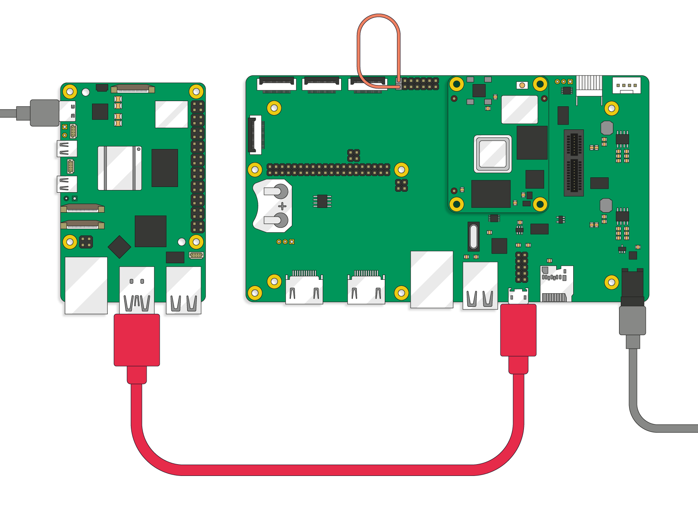
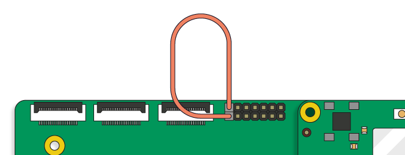

*Setting up a provisioning station and preparing Raspberry Pi devices with rpi-sb-provisioner*

This guide is for the people who run a provisioning station: installing it, configuring it in the web interface, connecting devices and dealing with failures. For every configuration variable see the [Configuration Reference](config_vars.md); for how the pieces fit together see [Architecture](architecture.md).

**Contents**

1. [Provisioning styles](#provisioning-styles)
2. [What you need](#what-you-need)
3. [Getting started](#getting-started)
4. [Upgrading from 2.3](#upgrading-from-23)
5. [Preparing devices](#preparing-devices)
6. [Monitoring progress](#monitoring-progress)
7. [Troubleshooting](#troubleshooting)
8. [The manufacturing database](#the-manufacturing-database)
9. [Customisation](#customisation)
10. [Automation and auditing](#automation-and-auditing)
11. [Quick reference](#quick-reference)

# Provisioning styles

Provisioning a device means programming its security settings and writing its operating system so it is ready to ship. The provisioner offers three styles, chosen under **Options → Security Configuration → Provisioning Style**:

| Style (tile)    | Configuration value | What it does                                                         | When to use it                                    |
|-----------------|---------------------|----------------------------------------------------------------------|---------------------------------------------------|
| **Secure Boot** | `secure-boot`       | Secure boot, encrypted storage and a device-unique key               | Production devices                                |
| **FDE Only**    | `fde-only`          | Encrypted storage and a device-unique key, without secure boot       | Encryption without secure boot restrictions       |
| **Naked**       | `naked`             | Writes the operating system only: no encryption, no secure boot      | Development, or where security is not required    |

With secure boot, a device runs only software signed with your private key; each stage of the boot chain is verified before it runs. With encrypted storage, the root filesystem is held in a LUKS container whose key is tied to the device, so storage removed from one device cannot be read elsewhere.

Two kinds of OS image are supported:

- an uncompressed or compressed disk image (`.img`, `.img.xz`, `.img.zst`), typically built with [pi-gen](https://github.com/RPi-Distro/pi-gen);
- an IDP (Image Description Provisioning) artefact built by `rpi-image-gen`, uploaded as a `.tar.xz` or `.tar.zst` archive. Its descriptor carries the partition layout, encryption and storage settings, so the web interface fills in the device and encryption settings from it. An IDP artefact is provisioned by the IDP provisioner whichever style is selected; secure boot is still applied during bootstrap.

# What you need

## Supported devices

- Raspberry Pi 5 and Compute Module 5
- Raspberry Pi 4 and Compute Module 4
- Raspberry Pi Zero 2 W (FDE Only or Naked; it has no secure boot)

## The provisioning computer

- A Raspberry Pi 5, or another Raspberry Pi running 64-bit Raspberry Pi OS (Bookworm or newer). The package is built for arm64 only.
- The official Raspberry Pi 27 W USB-C power supply.
- At least 32 GB of free storage for images and temporary files.

## Cables and accessories

| Device to prepare             | You need                                                           |
|-------------------------------|--------------------------------------------------------------------|
| Raspberry Pi 5                | USB-A to USB-C cable                                               |
| Raspberry Pi 4                | USB-A to USB-C cable                                               |
| Compute Module 5              | USB-A to USB-C cable, Compute Module 5 IO Board, one jumper wire   |
| Compute Module 4              | USB-A to micro-USB B cable, Compute Module 4 IO Board, one jumper wire |
| Raspberry Pi Zero 2 W         | USB-A to micro-USB B cable, an empty SD card                       |

For Compute Modules, connect the provisioning computer to the IO Board like this:

*A correctly connected provisioning system*

> **Important**
>
> Do not connect other USB devices to the IO Board during provisioning. The provisioning Raspberry Pi can supply only 900 mA to the connected device.

> **Tip**
>
> If the provisioning computer and the device are on the same Ethernet network, images can be sent over the fastboot TCP data plane, which is usually much faster than USB. USB is still needed for control commands.

# Getting started

## Install

    sudo apt update && sudo apt full-upgrade -y
    sudo apt install -y rpi-sb-provisioner

This installs the provisioning services and the web interface, `rpi-provisioner-ui.service`, which starts straight away.

## Sign in

Open the web interface on the provisioning computer:

    xdg-open http://localhost:3142

Sign in with a system account on the provisioning computer. Only members of the `rpi-sb-provisioner` group can sign in. When the package creates that group it adds the first user (UID 1000, the account created when Raspberry Pi OS was set up); an image built before that user existed has an empty group. To add an operator:

    sudo adduser <username> rpi-sb-provisioner

Treat membership like `sudo` access: the web interface runs as root, and an operator can do anything the provisioner can, including installing hook scripts that run as root.

Once signed in, your user name appears at the right of the navigation bar (it opens [API tokens](#api-tokens)) beside **Sign out**. The navigation bar holds **Devices**, **Options**, **Customisation**, **Services**, **Manufacturing Database**, **Audit Log** and **Code Scanner**.

### Viewing without signing in

The Devices page, a device's own page and the Code Scanner can be viewed without signing in, so a screen on the production line can show progress. Such viewers see serial numbers, USB ports, addresses and progress, but not logs, per-device overrides, settings or records, and cannot change anything. To require signing in for everything, turn off **Options → Web Interface → Show devices and the code scanner without signing in**, or set `RPI_SB_PROVISIONER_PUBLIC_DASHBOARD` to empty or `0`.

### Using the interface from another machine

The interface listens on 127.0.0.1 only, on port 3142 (HTTP) and 3143 (HTTPS, with a self-signed certificate kept in `/var/lib/rpi-sb-provisioner/tls`). Signing in from another machine needs HTTPS: plain HTTP sign-ins from elsewhere are refused. To listen on the network, override the service with `sudo systemctl edit rpi-provisioner-ui` and give `rpi-provisioner-ui` an `--address`. The certificate's SHA-256 fingerprint is logged when the service starts, so you can check it before accepting the browser warning:

    journalctl -u rpi-provisioner-ui | grep fingerprint

The interface answers only to requests addressed to `localhost`, this computer's host name or one of its IP addresses. Behind a reverse proxy with its own name, add `--allowed-host <name>`. See the [nginx example](../nginx-example/README.md).

The Code Scanner needs the camera, which browsers allow only over HTTPS or on the provisioning computer itself, so its link is hidden elsewhere.

## Configure the station

Click **Options**. The page is titled **Configuration Options**, and changes are saved as you make them; text fields save when you leave them. The sections, in order:

### OS Image

Under **Available Images**, click **Upload New Image**, then drop a file or click **Choose a file…**. Select an uploaded image to use it. Each image shows its details (IDP artefacts show their **IDP Metadata**), and offers **Deselect Image**, **Delete Image** and, for disk images, **Generate Boot Package** (with signing material configured) and **Clear Cached Files**.

### Device & Firmware

- **Device Family**: Raspberry Pi 5, Raspberry Pi 4 or Raspberry Pi Zero 2 W.
- **Storage Type**: SD Card, eMMC or NVMe (NVMe is not offered for Zero 2 W).
- **RPIBOOT GPIO Pin** (Raspberry Pi 4 family only): the GPIO that will put a device into RPIBOOT mode. It is burned into OTP with the secure boot key on the first secure-boot provisioning of each device and can never be changed. GPIO 8 is recommended. See the [Raspberry Pi 4 guide](device-guidance/pi4.md).
- **Device Firmware** (optional): click **Browse Available Firmware**, choose a version to read its release notes, then **Use This Firmware**, or **Use Default Firmware**. The page shows which bootloader firmware devices will get.
- **Bootloader Configuration**: choose **Default**, the package's configuration for the selected style, or **Custom**. Each tile shows the boot order devices will get. **Custom** opens the editor at `/options/bootloader-config` (**Create** the first time, **Edit** afterwards); see [Bootloader configuration](#bootloader-configuration). **Boot selected storage first** moves the selected storage to the front of the boot order. A configuration file kept elsewhere can be named under **Use a file managed outside the provisioner…**.

### Security Configuration

- **Provisioning Style**: Secure Boot, FDE Only or Naked (Secure Boot is not offered for Zero 2 W).
- **Encryption Cipher** (for encrypted styles): AES-XTS, hardware-accelerated and recommended on Raspberry Pi 5, or Adiantum, recommended for devices without AES acceleration.
- **Bootloader Signing Key (RSA 2048-bit)** (Secure Boot only), on two tabs:
  - **PEM Key File**: **Add a PEM key**, then drop or choose the file. A new key joins **Saved PEM keys** and is used only once you choose **Use for provisioning**; the first key you add is used straight away.
  - **PKCS#11 / HSM**: **Detect keys on HSM**, choose a key label, and enter the **HSM PIN** with **Validate & Save PIN**. See the [HSM Support Guide](hsm-support.md).

  If a stored key or PIN is unencrypted at rest, a banner says so and this section offers **Encrypt at rest**.

### Storage & Output

- **Work Directory** (optional, recommended): `RPI_SB_WORKDIR`, a cache of signed and prepared files reused between devices, for example `/srv/rpi-sb-provisioner/workdir`. It is used only if root alone can write to it; otherwise each run uses a fresh temporary directory. It is emptied whenever settings are saved, the firmware or signing key changes, or the package is upgraded.
- **Manufacturing Database** (optional): `RPI_SB_PROVISIONER_MANUFACTURING_DB`, by default `/srv/rpi-sb-provisioner/manufacturing.db`. Use local storage only.
- **Keypair Storage Directory** (optional): where captured device key pairs go. Left blank, they are kept with the device's logs in `/var/log/rpi-sb-provisioner/<serial>/keypair`, readable by root only.

### Cloud Services

To register each device with Raspberry Pi Connect for Organisations, enter a **Connect Management API Access Token** (from the Settings tab of your Connect organisation). Optionally, also set:

- **Description Prefix**: shown in the Connect audit log, before the board type and serial number.
- **Device Name**: the device's name in Connect. `{board}` and `{serial}` are filled in for each device; left blank, the name is `{board}-{serial}`, for example `cm5-8399ccde61e0280b`.
- **Tags**: comma-separated Connect tags for every device, such as `production, line2`.

### Web Interface

**Show devices and the code scanner without signing in**; see [Viewing without signing in](#viewing-without-signing-in).

### Hardware Security

Two permanent locks, applied to the devices you provision and never to the provisioning computer. They take effect only with the Secure Boot style, on Raspberry Pi 4 and 5:

- **Lock JTAG access on provisioned devices** (`RPI_DEVICE_LOCK_JTAG`). JTAG is not locked by default. Once locked, Raspberry Pi engineers cannot help debug hardware faults on that device.
- **Write-protect the EEPROM on provisioned devices** (`RPI_DEVICE_EEPROM_WP_SET`). Bootloader and EEPROM updates, security fixes included, are no longer possible on that device.

Neither can be undone. Turn them on only once a test device has provisioned successfully with your final configuration.

The help text beside each option explains it further; the [Configuration Reference](config_vars.md) covers every variable.

# Upgrading from 2.3

Release 2.4.0 changes how the station is accessed. Before upgrading:

- **Operators must sign in.** Add every operator to the `rpi-sb-provisioner` group (see [Sign in](#sign-in)).
- **Scripts need an API token.** Create one under [API tokens](#api-tokens) and send it as `Authorization: Bearer <token>`.
- **State-changing routes are POST-only and need the CSRF token**, so anything driving the old GET routes stops working.
- **Behind a reverse proxy**, give its name with `--allowed-host` and sign in over HTTPS. [nginx-example/README.md](../nginx-example/README.md) explains how to undo the old HTTP Basic setup.
- **New hook scripts arrive disabled**, and **a new signing key is used only once chosen**, unless it is the first.
- **The workdir cache is emptied**, so the first device after the upgrade is signed afresh.

# Preparing devices

Once configured, provisioning is automatic:

1. Connect the device.
2. Watch progress in the web interface.
3. Disconnect the device when it has finished (see [When is the device ready?](#when-is-the-device-ready)).

A typical run takes about 3 minutes for a 2.6 GB OS image.

## Connecting the device

### Compute Module 4 or Compute Module 5

1. Fit the Compute Module to the IO Board.
2. Bridge the two **disable eMMC Boot** pins with the jumper wire.
3. Connect the IO Board to the provisioning computer with the USB cable.

*Bridge the 'disable eMMC Boot' pins with a jumper wire*

### Raspberry Pi 5

1. Hold down the power button.
2. While holding it, connect the USB-C cable to the provisioning computer.
3. Release the button once the device is recognised.

The device reboots between phases by itself; leave it connected. See the [Raspberry Pi 5 guide](device-guidance/pi5.md).

### Raspberry Pi 4

Raspberry Pi 4 has no power button, so it enters RPIBOOT mode through a GPIO held to ground. Choose the pin under **RPIBOOT GPIO Pin** before secure-boot provisioning. See the [Raspberry Pi 4 guide](device-guidance/pi4.md).

### Raspberry Pi Zero 2 W

Insert an empty SD card and connect to the port marked **USB**, not **PWR IN**. See the [Raspberry Pi Zero 2 W guide](device-guidance/zero2.md).

To limit provisioning to particular USB ports, for example the head ports of a programming jig, see [USB Port Restriction](usb-port-restriction.md).

## What happens during provisioning

**Bootstrap** (`rpi-sb-bootstrap@`)

- The device is recognised in RPIBOOT mode.
- For secure boot, the hash of your signing key is written to the device's OTP. This is permanent.
- The bootloader and its configuration are written, unless skipped for this device.
- A small Linux environment running a fastboot daemon is loaded onto the device.

**Triage** (`rpi-sb-triage@`)

- The device's unique key is provisioned and locked if needed. It is used to unlock the encrypted root filesystem and to register with Raspberry Pi Connect.
- The device's public key is captured.
- The provisioner is chosen: `rpi-idp-provisioner@` for an IDP artefact, otherwise `rpi-sb-provisioner@`, `rpi-fde-provisioner@` or `rpi-naked-provisioner@` according to the provisioning style.

**Provisioning**

- **IDP artefact:** the descriptor and sparse images are sent with the device-side IDP fastboot commands, which create the partitions and encryption and write the images. For secure boot, the boot slots are signed.
- **Secure Boot:** the storage is partitioned, a LUKS container is created with the device's key, the operating system is written into it, and signed boot files are installed.
- **FDE Only:** as Secure Boot, but the boot files are not signed.
- **Naked:** the storage is partitioned and the operating system written as it is.

Each service is named after the device's serial number, for example `rpi-sb-provisioner@<serial>.service`.

## When is the device ready?

When the Devices page shows it as finished. The provisioner turns off the device's power LED as its last step. The device can then be disconnected and deployed.

# Monitoring progress

## In the web interface

- **Devices** shows every connected device, live. Choose between **Device cards** (the default), **Topology map** and **Port tree**, a text view of the USB topology.
- Click a device to open its page: its current state, **State History**, **Per-device Overrides**, and its **Provisioner Log**, **Bootstrap Log** and **Triage Log**. Logs and overrides need an operator.
- **Services** (page title **System Services**) lists the provisioning units with their load and run state. **View Logs** shows a unit's journal.

## On the command line

    systemctl list-units 'rpi-*'
    tail -f /var/log/rpi-sb-provisioner/<serial>/provisioner.log

Each device's directory under `/var/log/rpi-sb-provisioner/` also holds `bootstrap.log` and `triage.log`. The logs are readable by root and the `rpi-sb-provisioner` group.

# Troubleshooting

## Step 1: read the logs

Open the device from **Devices** and read its logs; the error is usually stated plainly near the end. For more detail, read the journal of the unit that failed, which **Services → View Logs** also shows:

    journalctl -u rpi-sb-bootstrap@<instance>
    journalctl -u rpi-sb-provisioner@<serial>

Use `rpi-fde-provisioner@`, `rpi-naked-provisioner@` or `rpi-idp-provisioner@` for the other styles.

## Step 2: clear the cache

If a work directory is set, stale cached files can be cleared from **Options → OS Image**: select the image and click **Clear Cached Files**. This empties the whole work directory. From the command line, substituting your `RPI_SB_WORKDIR`:

    sudo find /srv/rpi-sb-provisioner/workdir -mindepth 1 -maxdepth 1 -exec rm -rf -- {} +

Saving settings, changing firmware or signing key, and upgrading the package all empty it already. Without a work directory there is no cache to clear.

## Step 3: try again

Disconnect the device and connect it again.

## Common problems

### Device not detected

- Try another USB cable or port.
- Check the connection method for the device type; on Raspberry Pi 5, the power button must be held before the cable goes in.
- On a Compute Module, check the jumper bridges the right pins.
- If a USB port allowlist is configured, check the port is on it.

### Provisioning stops

- Read the logs (step 1) and clear the cache (step 2).
- Check there is enough free space.
- Try another device, to see whether the fault is with this one.

Every fastboot step has a time limit, and a board that stops answering is given up within about 10 seconds, so a run should fail with a reason rather than hang.

### The board refuses the bootcode

The bootstrap log says the board "refused the bootcode it was sent, three times". A board provisioned with secure boot before holds a customer key in OTP and refuses unsigned bootcode. If it holds this station's key, turn on **Re-provision Device** for it (below). A faulty USB cable or connection can fail the same way.

### Per-device overrides

On a device's page, under **Per-device Overrides**, each override can be **Off**, **One-time** (cleared after the next provisioning cycle) or **Persistent**:

- **Skip EEPROM Update**: skips writing the EEPROM and bootloader during bootstrap, for devices that already have the right EEPROM configuration or are already signed.
- **Re-provision Device** (Raspberry Pi 5 family only): provisions a device that has been provisioned before, instead of skipping it, re-signing the bootcode from the original firmware.

The same overrides can be set from the command line. An empty file is persistent; a file containing `once` is one-time:

    sudo touch /etc/rpi-sb-provisioner/special-skip-eeprom/<serial>
    sudo touch /etc/rpi-sb-provisioner/special-reprovision-device/<serial>

To find any overrides set for a device:

    sudo find /etc/rpi-sb-provisioner -name <serial>

### Bootstrapping without provisioning

To leave devices in fastboot mode after bootstrap, mask triage until the next reboot:

    sudo systemctl mask --runtime rpi-sb-triage@.service

Reboot the provisioning computer to restore full provisioning.

# The manufacturing database

The database is on by default, at `/srv/rpi-sb-provisioner/manufacturing.db`. Each provisioned device gets a record holding, among other things: serial number, board, revision, processor, memory and manufacturer; Ethernet, Wi-Fi and Bluetooth MAC addresses; eMMC size and CID, and RPi DUID; EEPROM details and bootloader build date; whether signed boot is on and the public key is in OTP; JTAG lock and EEPROM write protection as requested; the OS image's file name and SHA-256; the signing key's hash and label; Raspberry Pi Connect registration and device ID; and the provisioning time.

## Viewing it

Click **Manufacturing Database** to browse the records, and **Export to CSV** to download them. Scripts can read them through the [Manufacturing API](api/manufacturing.md).

## From the command line

The records are in the `devices` table:

    sudo sqlite3 -header -csv /srv/rpi-sb-provisioner/manufacturing.db "SELECT * FROM devices;" > devices.csv

Devices with secure boot enabled:

    sudo sqlite3 -header -csv /srv/rpi-sb-provisioner/manufacturing.db "SELECT serial FROM devices WHERE secure = 1;" > secured_devices.csv

The database is safe for one station only; do not keep it on a network drive. For many stations, see the [Scaling Guide](mass-provisioning-guidance/scaling.md).

# Customisation

## Hook scripts

Hook scripts extend provisioning at fixed stages. Click **Customisation**: the **Customisation Scripts** page has a tab per provisioner (Secure Boot, Full-disk Encryption, Naked and IDP Artefact) and a card per stage, each showing **Enabled**, **Disabled** or **Not set up**.

| Stage               | Runs                                                             | Not for IDP |
|---------------------|------------------------------------------------------------------|-------------|
| `bootstrap`         | When a device is detected, before provisioning begins            | ✓           |
| `provision-started` | At the start of provisioning; for LEDs or rig signalling         |             |
| `bootfs-mounted`    | After the boot image is mounted, before it is changed            | ✓           |
| `rootfs-mounted`    | After the root filesystem is mounted, before it is packaged      | ✓           |
| `post-flash`        | After the boot and root filesystems are written to the device    |             |
| `provision-failed`  | When bootstrap, triage or provisioning fails; for a red LED, say |             |

**Create Script** makes a script from a template that documents the stage's arguments and environment. A new script is created **disabled**: click **Enable** when it is ready. **Edit** opens the editor, with **Save** and the stage's help; **Disable** and **Delete** do what they say. Scripts are kept in `/etc/rpi-sb-provisioner/scripts/` as `<provisioner>-<stage>.sh`, and a script that is not executable is skipped.

Hooks receive stage-specific arguments and environment such as `TARGET_USB_PATH`, `TARGET_DEVICE_PATH` and `TARGET_DEVICE_SERIAL`. `post-flash` hooks also receive the manufacturing record (`BOARDNAME`, `ETH_MAC`, `OS_IMAGE_SHA256` and so on). A `provision-failed` hook receives `PROVISION_FAILED_REASON` (for example `board-absent`, `board-lost`, `bootcode-refused` or `timed-out`) and `PROVISION_FAILED_PERMANENT`, set to `1` when retrying will not help. Each hook may run for `RPI_SB_HOOK_TIMEOUT` seconds, 1800 by default.

Every save, upload, enable, disable and delete is recorded in the audit log. See the [Customisation API](api/customisation.md) for the full contract.

## Boot configuration (`config.txt`)

To change `config.txt`, edit it in your OS image and upload the image again. New devices get it.

## Bootloader configuration

Choose **Custom** under **Options → Device & Firmware → Bootloader Configuration** and click **Create** or **Edit** to open the editor. It starts from the default. The **Settings** panel beside it shows the Raspberry Pi documentation for the setting under the cursor, and can be searched. **Save** checks the file and the EEPROM's size limit before saving to `/etc/rpi-sb-provisioner/bootloader.conf`, and the next device to bootstrap gets it. **Use the default instead** switches back without deleting your configuration.

# Automation and auditing

## API tokens

Scripts use the HTTP API with a token instead of signing in. Click your user name in the navigation bar to open **API Tokens**, enter a **Label** and click **Create token**. Copy the token straight away; it is not shown again. Send it with each request:

    curl -H "Authorization: Bearer <token>" http://localhost:3142/api/v2/manufacturing

A token acts as the operator who created it and stops working if they leave the `rpi-sb-provisioner` group. **Revoke** removes it. See the [API documentation](api/README.md) and [Authentication](api/authentication.md).

## Audit log

**Audit Log** records requests, file access, journal reads and every sign-in attempt, with the user and client address of each. Filter it by **Event Type** (All Events, API Access, File Access, Systemd Log, Sign-ins and tokens), **Start Date**, **End Date** and **Limit**, then **Apply Filters**.

# Quick reference

| Task                   | How                                                                                         |
|------------------------|---------------------------------------------------------------------------------------------|
| Install                | `sudo apt install rpi-sb-provisioner`                                                       |
| Open the interface     | <http://localhost:3142>, then sign in                                                       |
| Add an operator        | `sudo adduser <name> rpi-sb-provisioner`                                                    |
| Configure              | **Options**                                                                                 |
| Watch devices          | **Devices**                                                                                 |
| Read a device's logs   | **Devices** → the device, or `/var/log/rpi-sb-provisioner/<serial>/provisioner.log`         |
| Read a unit's journal  | **Services** → **View Logs**                                                                |
| Export records         | **Manufacturing Database** → **Export to CSV**                                              |
| Clear the cache        | **Options** → OS Image → **Clear Cached Files**                                             |
| Re-provision a device  | The device's page → **Per-device Overrides** → **Re-provision Device**                      |
| Script the API         | Your user name → **API Tokens** → **Create token**                                          |
| Limit to jig ports     | A `*.conf` in `/etc/rpi-sb-provisioner/usb-ports.d/`; see [USB Port Restriction](usb-port-restriction.md) |
| Device ready?          | Finished on **Devices**, and its power LED is off                                           |

| Device                 | Connection                                                                                  |
|------------------------|---------------------------------------------------------------------------------------------|
| Compute Module 4/5     | Jumper on **disable eMMC Boot** → connect USB                                               |
| Raspberry Pi 5         | Hold power button → connect USB → release                                                   |
| Raspberry Pi 4         | Set **RPIBOOT GPIO Pin**; hold that GPIO to ground → connect USB                            |
| Raspberry Pi Zero 2 W  | Empty SD card → connect to the **USB** port. No secure boot: use FDE Only or Naked          |

Report problems at <https://github.com/raspberrypi/rpi-sb-provisioner/issues>, with the device type, the error and the logs.
